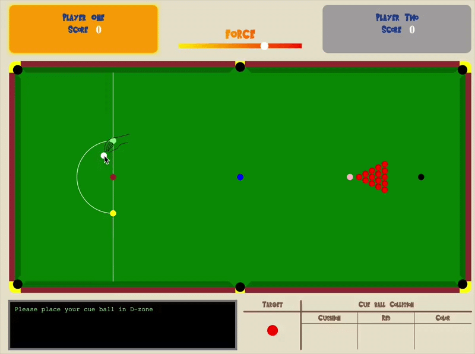
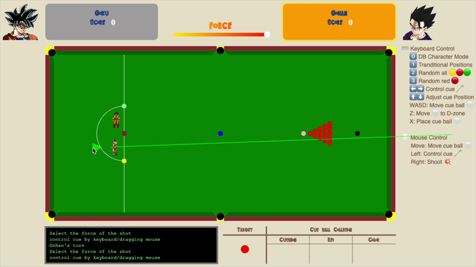
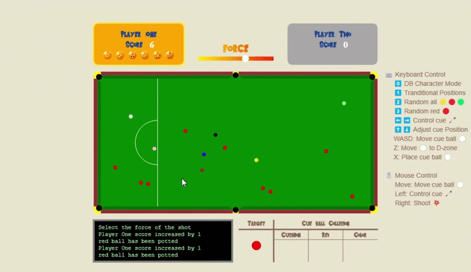

# 2D Snooker Game with Dragon Ball Elements

> An early BSc Computer Science Graphics Programming project exploring 2D physics engine integration (`matter.js`), custom rendering loops (`p5.js`), Object-Oriented Programming (OOP), and procedural graphics with anime-inspired mechanics.

   

## 💡 Overview & Academic Purpose

Developed early in my BSc Computer Science studies for a **Graphics Programming** module, this project focuses on architectural organization, procedural graphics, and engine integration. The goal was to bridge a 2D rigid-body physics engine (`matter.js`) with a custom visual rendering pipeline (`p5.js`) while maintaining a clean, modular codebase.

Rather than replicating a full commercial snooker simulation, the game was built to fulfill specific university coursework requirements, including demonstrating originality by deviating from standard snooker rules. To meet this creative brief while pushing the technical complexity, I designed custom **Dragon Ball** extensions featuring dynamic physical modifiers (such as altered mass, reduced friction, and impulse forces) and procedural visual effects.

---

## 🎮 Gameplay & Technical Highlights

### 1. Core Snooker Mechanics

Implements the baseline 2D snooker physics, collision handling, and rule-based gameplay required by the coursework brief. It serves as the foundational rigid-body sandbox connecting `matter.js` physics calculations to the `p5.js` canvas loop.



### 2. Extension: Dragon Ball Character (OOP Architecture)

To expand beyond the core requirements without duplicating physics and movement logic, I reused and extended the existing Cue Ball class to create the playable Dragon Ball character. This demonstrates practical Object-Oriented Programming (OOP) principles, leveraging class inheritance and modular design to introduce custom abilities and state-driven physical modifiers while keeping the codebase clean and maintainable.



### 3. Extension: Shenron Summoning Clouds (Perlin Noise & Optimization)

To apply core Graphics Programming concepts, I used "Perlin noise" to procedurally generate randomized storm clouds for the Shenron summoning sequence. Calculating dense, real-time noise initially caused significant frame-rate drops (lag). To resolve this performance bottleneck without sacrificing visual atmosphere, I refactored the effect into overlapping, semi-transparent cloud layers, achieving smooth rendering and rich visual depth simultaneously.



---

## 🚀 How to Run Locally

**Prerequisites:** Visual Studio Code with the **Live Server** extension installed.

**Clone the repository:**

```bash
git clone https://github.com/jeremyf2020/snooker-game.git
```
